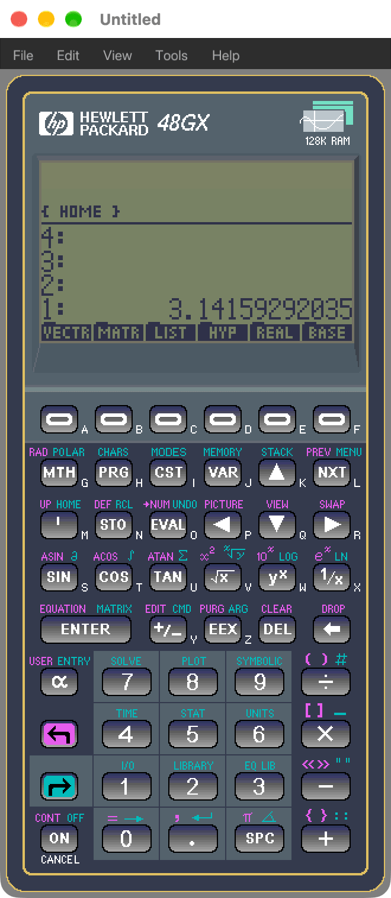
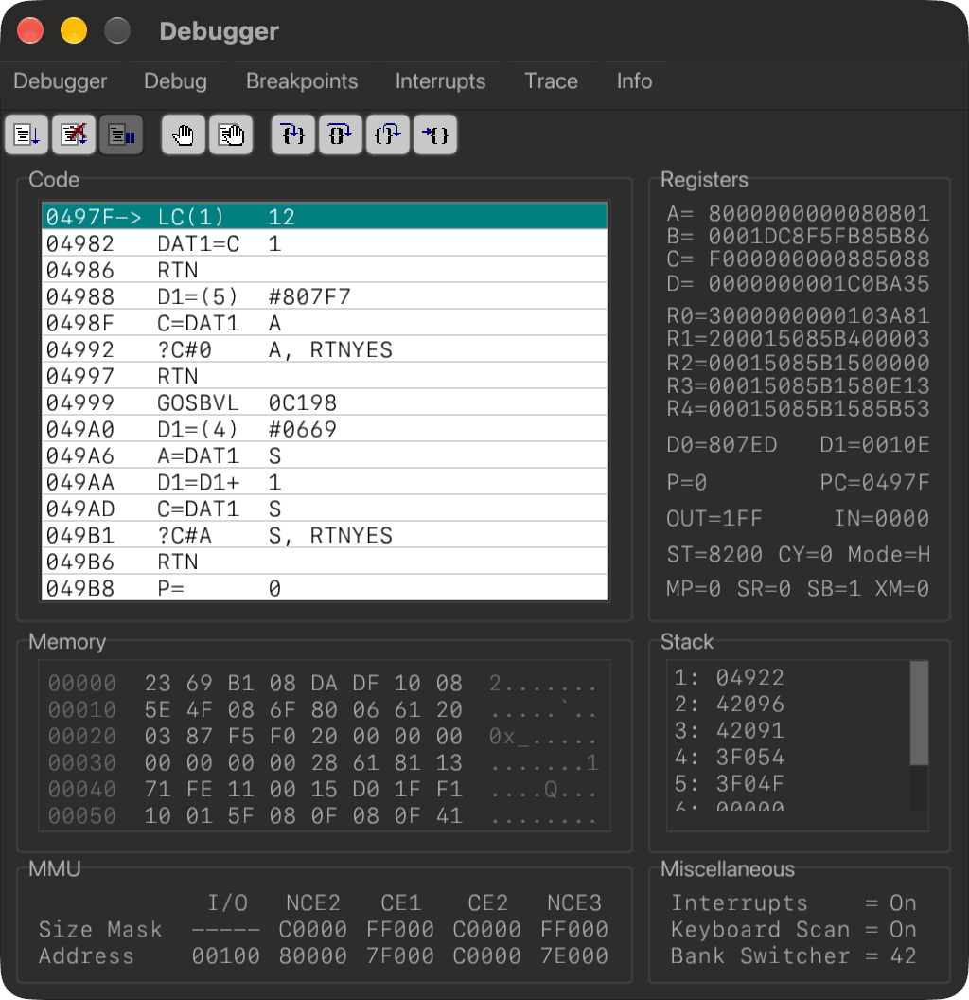

# Emu48/SDL

**Emu48 for macOS and Linux**: an unofficial port of the HP 38G/39G/40G/48SX/48GX/49G
emulator Emu48 1.68 to the SDL3 library.

> [!IMPORTANT]
> **Emu48 is the work of Christoph Gießelink and Sébastien Carlier.** The original
> Emu48 for Windows, its documentation and its KML scripts are on Christoph's page
> **<https://hp.giesselink.com/emu48.htm>**. That is the original and the reference.
>
> Emu48/SDL is a port of it, made and maintained by Fabian Hassler. It isn't maintained
> by Christoph Gießelink, so please report problems of this port
> [here](https://github.com/FabianHassler/Emu48-SDL/issues), not to him.
> On Windows, use the original Emu48.

<p align="center">
  
  &nbsp;
  
</p>

## What it is

The emulation, the debugger and all dialogs are the unchanged C code of Emu48 1.68.
Only the Windows parts are replaced: windows, drawing, menus and
dialogs are drawn with [SDL3](https://libsdl.org) and the
[Nuklear](https://github.com/Immediate-Mode-UI/Nuklear) GUI library, and the operating
system calls are mapped to POSIX. So Emu48/SDL behaves like Emu48 for Windows:

- the same menus, dialogs, settings and keyboard shortcuts
- the complete assembly debugger with breakpoints, memory, stack and history windows
- KML scripts and calculator images of Emu48 for Windows work unchanged
- state files (`.e48`, `.e49`, …) are exchangeable with Emu48 for Windows
- sound, serial ports (wire and IR, also USB serial adapters) and the IR printer (UDP)
- MkShared, the RAM card maker for port 2 of the HP48SX/GX, as a command line program

## Download

Packages are on the [Releases](https://github.com/FabianHassler/Emu48-SDL/releases) page.

| Platform | Package | Requirements |
|---|---|---|
| macOS, Apple Silicon | `Emu48-SDL-…-macOS-AppleSilicon.zip` | macOS 11 or later, M1 or newer |
| macOS, Intel | `Emu48-SDL-…-macOS-Intel.zip` | macOS 11 or later, Intel processor |
| Linux | `Emu48-SDL-…-Linux-x86_64.tar.gz` | x86-64, glibc 2.28 or later, X11 or XWayland |
| Windows | – | use the [original Emu48](https://hp.giesselink.com/emu48.htm) |

Like the original, Emu48/SDL is small: one program file of about 2 MB with SDL3 and the
manual built in, a download of less than 1 MB, no installer and no further libraries. For
this reason there are separate packages for Apple Silicon and Intel Macs.

**macOS:** unpack the zip file and copy the `Emu48` folder to any place, e.g. into your
Applications folder. The app isn't signed by Apple, so macOS refuses to open it at the first
start. Open it with a right click on `Emu48.app` and *Open*, or allow it in *System Settings
→ Privacy & Security → Open Anyway*. In a terminal the same is done with

```sh
xattr -dr com.apple.quarantine Emu48.app
```

**Linux:** unpack the tar.gz file and start `./emu48` in its folder. SDL3 is linked
statically; the program only needs the X11 and sound libraries of a desktop installation
(PulseAudio or PipeWire). The file dialogs need the xdg-desktop-portal service of the
desktop or the `zenity` program.

## Getting started

Emu48 needs a **ROM image** of the calculator and a **KML script** (a "skin": the calculator
image and its key layout). Both are free downloads from [hpcalc.org](https://www.hpcalc.org);
HP has allowed the download of the HP48 ROM images since 2000.

1. **ROM image:** download the latest HP 48GX ROM,
   [revision R](https://www.hpcalc.org/details/4368), or the HP 48SX ROM,
   [revision J](https://www.hpcalc.org/details/4371). Unpack it and rename the file to the
   name the KML scripts expect: `gxrom-r` to `ROM.48G`, `sxrom-j` to `ROM.48S`.
2. **KML scripts:** for example [HP 48G(X) and HP 48S(X) skins](https://www.hpcalc.org/details/6644)
   by Leszek Ulman, used in the screenshot above, or the
   [Real Calcs KML scripts](https://www.hpcalc.org/details/3684). More scripts, also for the
   HP38G, HP39G, HP40G and HP49G, are on the
   [emulator page of hpcalc.org](https://www.hpcalc.org/hp48/pc/emulators/).
3. Put the ROM image and the unpacked KML scripts (`*.kml`, `*.kmi`, `*.bmp`) into one
   folder, the **Emu48 directory**. At the first start this is the folder `Documents/Emu48`
   in your home folder on macOS, created by Emu48, and the current directory on Linux.
4. Start Emu48. In *Choose Your KML Script*, set the *Emu48 Directory* to this folder with
   the **…** button if needed, choose a script and press **OK**. The calculator starts with
   "Memory Clear".
5. Use the calculator with the mouse or the keyboard. *File → Save As* saves the calculator
   with its memory in a state file (`.e48`), which is opened again at the next start.

The manual [doc/MANUAL.md](doc/MANUAL.md) explains all menus, settings and the debugger. It is
built into the program: *Help → Help Topics* shows it in a help window.

Settings are saved in `~/Library/Application Support/Emu48/Emu48.ini` (macOS) and
`~/.local/share/Emu48/Emu48.ini` (Linux).

## Differences to Emu48 for Windows

- A double click in the lists of the debugger can also be done with Option+click
  (Alt+click on Linux) or with the middle mouse button.
- On macOS, Control+click opens the context menu like a right click, and the Command key
  works like the Control key in keyboard shortcuts.
- Sub menus are shown as expandable items inside their menu.
- The PC keys are mapped by their position on a US keyboard, the letters by their label,
  so the keyboard mappings of the KML scripts work with any keyboard layout.
- Serial ports are the devices `/dev/tty.*` (macOS) and `/dev/ttyS*`, `/dev/ttyUSB*`,
  `/dev/ttyACM*` (Linux); any other device path, e.g. a pseudo terminal, can be typed into
  the Wire and IR fields. On Linux your user must be a member of the group owning the device
  (usually `dialout`).
- The baud rates 1920, 3840, 7680 and 15360 work when the serial driver supports them
  (most USB serial adapters).
- There is no DDE interface (a Windows-only way for other programs to exchange objects with
  Emu48) and no CONVERT program.

## Fixes to the original code

Bugs found while porting are fixed in the shared code, so they are fixed on all
platforms and can be given back to the original. [`CHANGES.TXT`](CHANGES.TXT) lists every
change to the files of Emu48, in the format of Christoph's change logs.

Christoph has taken over these fixes in his own versions:

- Saving a global or local name as an object wrote additional nibbles (`RPL_SkipOb()`).
- The garbage collection on damaged memory could hang the emulator; creating temporary
  memory checks the memory pointers first.
- The UDP address of the IR printer was initialized in a platform dependent member order.

Only in Emu48/SDL so far:

- A key held while saving a state file stayed pressed after loading it.
- Serial device names were cut after 16 characters, and a device not in the list was
  replaced by "disabled" when the settings were saved.

## Building from source

You need a C compiler, CMake 3.16 or later and SDL3 3.2 or later.

```sh
# macOS
brew install cmake sdl3
# Debian, Ubuntu
sudo apt install build-essential cmake libsdl3-dev
# Fedora
sudo dnf install gcc cmake SDL3-devel

cmake -S . -B build -DCMAKE_BUILD_TYPE=Release
cmake --build build
```

The program is `build/Emu48.app` on macOS and `build/emu48` on Linux, together with
`build/mkshared`. [`INSTALL.TXT`](INSTALL.TXT) describes the build with a static SDL3 like
the release packages; [the GitHub workflow](.github/workflows/build.yml) does exactly that.

The source files in `src/` keep the names and the style of Emu48 for Windows, so changes can be
compared with and given back to the original. The port itself is in the `SDL*` files:

| File | Content |
|---|---|
| `SDLPORT.H` | the subset of the Win32 API used by Emu48, on top of SDL3 and POSIX |
| `SDLMAIN.C` | main window, event loop, keyboard and mouse |
| `SDLGDI.C` | bitmaps and drawing (GDI) |
| `SDLMENU.C`, `SDLDLG.C`, `SDLUSER.C` | menus, dialogs and controls of `EMU48.RC`, drawn with Nuklear |
| `SDLOS.C`, `SDLBAUD.C` | files, threads, events, settings, serial ports |
| `SDLWAVE.C` | sound output |
| `SDLHELP.C` | help window with the manual `doc/MANUAL.md` |

The menus, dialogs, strings and bitmaps are read from the original `EMU48.RC` at build time.

## License

Emu48/SDL is free software under the GNU General Public License version 2 or later, see
[`COPYING.TXT`](COPYING.TXT).

- Emu48: Copyright © 1995 Sébastien Carlier, Copyright © Christoph Gießelink
- Disassembler (`DISASM.C`): Copyright © 1994 Eddie C. Dost
- SDL3 port: Copyright © 2026 Fabian Hassler
- SDL3: Copyright © Sam Lantinga, zlib license
- Nuklear: public domain / MIT license
- LodePNG: Copyright © Lode Vandevenne, zlib license
- ProggyClean font (built into Nuklear): Copyright © Tristan Grimmer, MIT license

HP and the names of the calculators are trademarks of HP Inc. This project is not affiliated
with HP.
